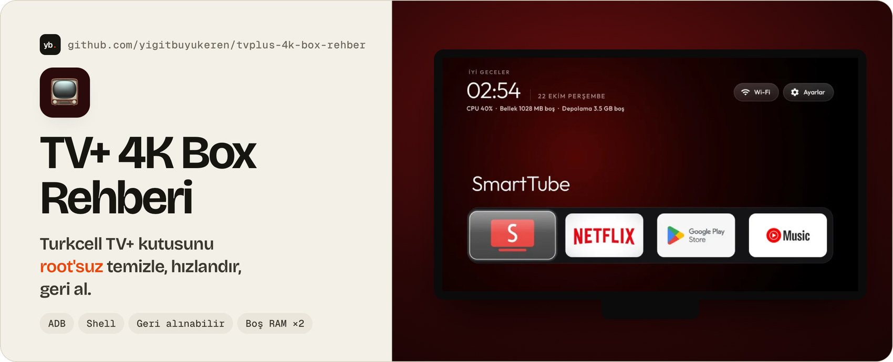
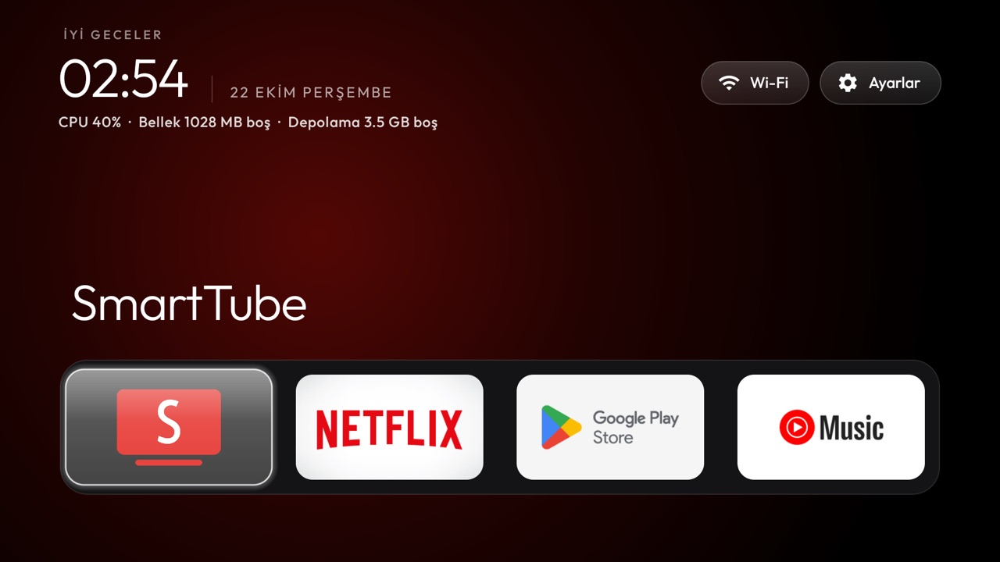
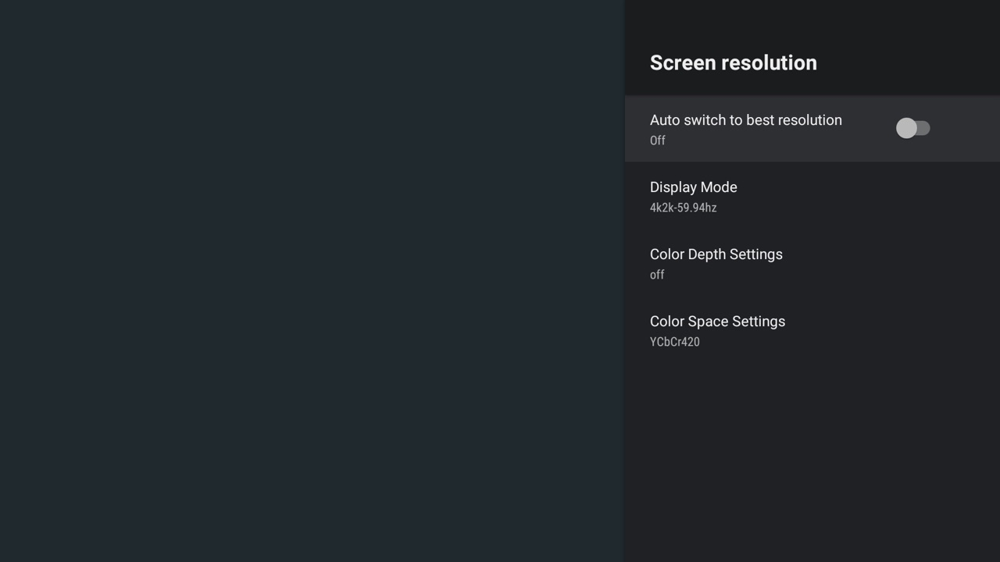

<a href="#-hızlı-başlangıç">
  <picture>
    <source media="(prefers-color-scheme: dark)" srcset="images/banner-dark.jpg">
    
  </picture>
</a>

<div align="center">

**[🚀 Hızlı başlangıç](#-hızlı-başlangıç)** &nbsp;·&nbsp; **[📚 Adım adım rehber](#-adım-adım-rehber)** &nbsp;·&nbsp; **[🧰 Betikler](#-betikler)** &nbsp;·&nbsp; **[❓ SSS](docs/10-sss.md)**

[](LICENSE)


[](https://github.com/yigitbuyukeren/tvplus-4k-box-rehber/commits/main)
[](https://github.com/Gathin23/cleanyourtv/pull/874)

🇹🇷 [Türkçe](#-türkçe) &nbsp;·&nbsp; 🇬🇧 [English](#-english)

</div>

<details open>
<summary><h2>🇹🇷 Türkçe</h2></summary>

Turkcell'in verdiği **TV+ 4K Box**'ı (SDMC DV6069Y) root'suz, geri alınabilir şekilde temizleme,
hızlandırma ve kişiselleştirme rehberi. Kutuya bir bilgisayardan Wi-Fi üzerinden ADB ile bağlanılır;
**kutu açılmaz, hiçbir şey silinmez, her adım tek komutla geri alınır.**

> [!NOTE]
> Bu bir **topluluk rehberidir**. Turkcell veya SDMC ile ilgisi yoktur, onlar tarafından desteklenmez.
> Kutu genelde operatöre aittir; değişiklik yapmadan önce sözleşmeni düşün. Her şey kendi sorumluluğundadır.

### 📈 Ne kazanırsın

| | Önce | Sonra |
|---|---|---|
| 🧠 **Boş RAM** (açılıştan sonra) | ~460 MB | **~930 MB** |
| 💾 **Takas (ZRAM) kullanımı** | ~185 MB | **~25 MB** |
| 🏠 **Ana ekran** | Google TV ana ekranı, öneri ve reklam satırları | Sade, reklamsız ana ekran ([cleanyourtv](https://github.com/Gathin23/cleanyourtv)) |
| ▶️ **YouTube** | Reklamlı | SmartTube: reklamsız, SponsorBlock |
| 🛡️ **Reklam/izleyici engelleme** | Yok | Sistem genelinde AdGuard DNS |
| 🖥️ **Monitör/TV'ye giden görüntü** | Bazı ekranlarda 4K + YCbCr 4:2:0 | Ekranın kendi çözünürlüğü, YCbCr 4:4:4 |
| 🎮 **Kumanda tuşları** | Uygulama kapatılınca çöken tuş servisi | İstediğin uygulamaya atanmış tuşlar |

<sub>Ölçümler tek bir kutudan; senin kutunda biraz farklı olabilir.</sub>

### 📸 Ekran görüntüleri

| Temizlikten sonra ana ekran | Görüntü ayarı | Güncellemeler çalışmaya devam eder |
|:---:|:---:|:---:|
|  |  |  |

### ⚠️ Bilmen gereken üç şey

1. 🔓 **Root yok, olmayacak.** Bootloader kilitli ve kilit açma yolu yok. Gerekmiyor da: ADB yetkisi bu rehberdeki her şeye yetiyor. Ayrıntı: [docs/08-root-ve-bootloader.md](docs/08-root-ve-bootloader.md).
2. 🎮 **Resmi YouTube'u kapatırsan kumanda tuşlarını yeniden ata.** Yoksa YouTube tuşu, kumandanın tuş servisini çökertir ve Google Play tuşu da çalışmaz olur. Ayrıntı: [docs/05-kumanda-tuslari.md](docs/05-kumanda-tuslari.md).
3. 🔌 **İş bitince ağ üzerinden hata ayıklamayı kapat.** Açık kalırsa ağdaki cihazlar kutuya bağlanmayı deneyebilir.

### 🚀 Hızlı başlangıç

**1. Bilgisayarda** (macOS örneği, Linux'ta da aynı):

```bash
brew install android-platform-tools
git clone https://github.com/yigitbuyukeren/tvplus-4k-box-rehber
cd tvplus-4k-box-rehber
```

**2. Kutuda:** **Ayarlar → Cihaz Tercihleri → Hakkında → "Yapı"ya 7 kez bas**, sonra
**Geliştirici seçenekleri → USB hata ayıklama: Açık**. Kutunun IP adresi:
**Ayarlar → Ağ ve İnternet → bağlı ağ**.

**3. Dört komut:**

```bash
export TV=192.168.1.50          # kendi kutunun adresi
adb connect $TV:5555            # TV'de çıkan izin sorusunu onayla
./scripts/backup.sh             # 1. önce yedek
./scripts/debloat.sh            # 2. gereksiz uygulamaları kapat
./scripts/optimize.sh           # 3. hız ve gizlilik ayarları
./scripts/status.sh             # 4. kontrol
```

Sonra yeni ana ekran, SmartTube, görüntü ayarı ve kumanda tuşları için aşağıdaki adımlara geç.
Her şeyi geri almak için: `./scripts/restore.sh`.

### 📚 Adım adım rehber

| | Konu | |
|:---:|---|---|
| 1 | 🔌 [Bağlanma](docs/01-baglanma.md) | Kutuyu ağda bulma, ADB'yi açma, ilk bağlantı |
| 2 | 🧹 [Yedek ve temizlik](docs/02-temizlik.md) | Hangi uygulama neden kapatılıyor, neye asla dokunulmuyor |
| 3 | 🏠 [Yeni ana ekran](docs/03-ana-ekran.md) | cleanyourtv ana ekranını bu kutuya göre derleyip kurma |
| 4 | 🖥️ [Görüntü ayarı](docs/04-goruntu.md) | 4:2:0 sorunu, çözünürlük ve renk ayarı |
| 5 | 🎮 [Kumanda tuşları](docs/05-kumanda-tuslari.md) | Tuş kodları, çökme sorunu ve tuşları yeniden atama |
| 6 | ▶️ [SmartTube](docs/06-smarttube.md) | Kurulum ve bu kutuya uygun ayarlar |
| 7 | ↩️ [Geri alma ve güncellemeler](docs/07-geri-alma.md) | restore.sh, güncelleme sonrası kontrol, iade öncesi |
| 8 | 🔓 [Root ve bootloader](docs/08-root-ve-bootloader.md) | Neden yapılamıyor, yapılsa ne kazanılırdı |
| 9 | 🔎 [Cihaz bilgileri](docs/09-cihaz-bilgileri.md) | Donanım, yazılım, paketler, video çözücüler |
| 10 | ❓ [Sık sorulanlar](docs/10-sss.md) | APK kurulur mu, TV+ silinir mi, Netflix HD kalır mı... |

### 🧰 Betikler

| Betik | Ne yapar | Kutuyu değiştirir mi |
|---|---|:---:|
| `scripts/backup.sh` | Paket listeleri, tüm ayarlar ve sistem özelliklerini `backup/` altına kaydeder | Hayır |
| `scripts/debloat.sh` | `scripts/debloat.txt` içindeki paketleri devre dışı bırakır | Evet, geri alınabilir |
| `scripts/optimize.sh` | Animasyon, arka plan sınırı, uyku süresi, reklam engelleyen DNS | Evet, geri alınabilir |
| `scripts/status.sh` | Listedeki paketlerin durumu, ana ekran, görüntü çıkışı, RAM | Hayır |
| `scripts/restore.sh` | Hepsini fabrika durumuna döndürür | Evet |

> [!TIP]
> Hepsi `DRY_RUN=1` ile kutuya hiçbir şey yazmadan ne yapacağını gösterir. Başka bir kutuda
> çalışmamak için model kontrolü yaparlar (`FORCE=1` ile atlanır).

### 📦 Bu rehberin dayandığı kutu

| | |
|---|---|
| **Model** | TV PLUS 4K BOX (SDMC `DV6069Y_TVPLUS`) |
| **İşlemci** | Amlogic, kart adı `faraday`, 4 çekirdek ARMv8, 32-bit Android |
| **RAM / depolama** | 2 GB / 4 GB kullanıcı alanı |
| **Yazılım** | Android TV 10, `QT.20230328`, güvenlik yaması 2023-02-05 |
| **Video çözücü** | H.264, HEVC, VP9 donanımla; **AV1 yok** |

Senin kutunda yazılım farklıysa paket adları değişmiş olabilir; `DRY_RUN=1` ile önce kontrol et.

### 🙏 Teşekkür ve lisans

- Ana ekran ve temizlik yaklaşımı: [Gathin23/cleanyourtv](https://github.com/Gathin23/cleanyourtv) (MIT). Bu kutunun listesi oraya da [eklendi](https://github.com/Gathin23/cleanyourtv/pull/874).
- YouTube istemcisi: [yuliskov/SmartTube](https://github.com/yuliskov/SmartTube).
- Bu repodaki metin ve betikler [MIT lisansı](LICENSE) ile.

🐞 Hata ya da farklı yazılım sürümü bulursan [issue aç](https://github.com/yigitbuyukeren/tvplus-4k-box-rehber/issues); özellikle `./scripts/status.sh` çıktısıyla gelen raporlar çok işe yarar. ⭐ İşine yaradıysa yıldız vermeyi unutma!

</details>

<details>
<summary><h2>🇬🇧 English</h2></summary>

A community guide for the **Turkcell TV+ 4K Box** (SDMC DV6069Y, Amlogic, Android TV 10), a set-top
box handed out by a Turkish operator. **Root-free and fully reversible over Wi-Fi ADB.**

| 🧹 **Tested debloat list** | 🧰 **Five scripts** | 🏠 **Clean home screen** | 🎮 **Remote fix** |
|:---:|:---:|:---:|:---:|
| A reason for every package | Backup, debloat, tune, status, restore, all with a dry-run mode | The [cleanyourtv](https://github.com/Gathin23/cleanyourtv) launcher and SmartTube | Remap the app keys so they keep working |

- 📈 Free RAM after boot went from **~460 MB to ~930 MB**; ZRAM use from ~185 MB to ~25 MB.
- 🖥️ Fixes the 2160p YCbCr 4:2:0 default on 1080p screens (back to 1080p, 4:4:4).
- 🔎 **Key finding:** disabling the stock YouTube app makes `com.sdmc.GlobalKey` crash on the YouTube button, which kills every app button (Play Store included) until a reboot. Remapping the keys through the launcher's accessibility service avoids it. This box's list is now part of cleanyourtv: [cleanyourtv #874](https://github.com/Gathin23/cleanyourtv/pull/874).

```bash
export TV=192.168.1.50 && adb connect $TV:5555
./scripts/backup.sh && ./scripts/debloat.sh && ./scripts/optimize.sh && ./scripts/status.sh
# undo everything: ./scripts/restore.sh   ·   preview first: DRY_RUN=1 ./scripts/debloat.sh
```

The docs are in Turkish; the scripts and `scripts/debloat.txt` are commented. Not affiliated with Turkcell or SDMC. Released under the [MIT License](LICENSE).

</details>
