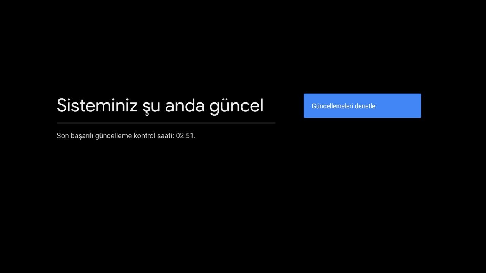

# 7. Geri alma ve güncellemeler

## Her şeyi geri almak

```bash
DRY_RUN=1 ./scripts/restore.sh   # önce ne yapacağını gör
./scripts/restore.sh
adb -s $TV:5555 reboot
```

`restore.sh` şunları yapar:

- `debloat.txt`'deki bütün paketleri açar (yorum satırına alınmış olanlar dahil, önceden
  kapatılmış olabilirler).
- Kullanıcı için kaldırılmış TV+ ve YouTube'u fabrika kopyasından geri kurar
  (`cmd package install-existing`).
- Eski ana ekranı açar ve varsayılan yapar.
- Animasyon, arka plan sınırı, uyku süresi ve DNS'i fabrika değerine döndürür.
- Kumanda tuş servisini kapatır.

Geri **almadıkları**:

- Yeni ana ekran ve SmartTube kurulu kalır: `adb uninstall com.gathin.tvhome`,
  `adb uninstall org.smarttube.stable`.
- Ekran çözünürlüğü ADB ile değiştirilemiyor; menüden geri al ([4. Görüntü](04-goruntu.md)).

## Tek bir uygulamayı geri açmak

```bash
adb -s $TV:5555 shell pm enable com.google.android.apps.mediashell   # örnek: Chromecast
```

ya da kutuda: **Ayarlar → Uygulamalar → Tüm uygulamalar / Sistem uygulamaları → uygulama → Etkinleştir**.

## Yazılım güncellemesinden sonra

Güncelleme servisine (`com.droidlogic.otaupgrade`) dokunulmuyor, güncellemeler gelir.



Güncelleme kapatılan bazı paketleri geri açabilir ya da varsayılan ana ekranı sıfırlayabilir:

```bash
./scripts/status.sh     # "AÇIK" yazan paket var mı, ana ekran hâlâ yeni mi?
./scripts/debloat.sh    # varsa tekrar kapat
```

Güncellemede paket adları değiştiyse issue açarsan liste güncellenir.

## Kutuyu iade etmeden önce

1. `./scripts/restore.sh`
2. `adb uninstall com.gathin.tvhome` ve `adb uninstall org.smarttube.stable`
3. **Ayarlar → Cihaz Tercihleri → Hakkında → Fabrika ayarlarına sıfırla**

## İş bitince

**Geliştirici seçenekleri → USB hata ayıklama: Kapalı.** İleride bir şey değiştireceğin zaman tekrar aç.

Sonraki: [8. Root ve bootloader](08-root-ve-bootloader.md)
